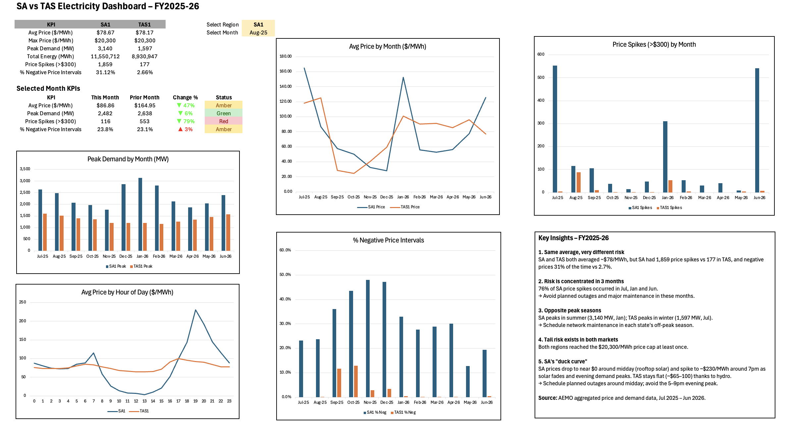

# SA vs TAS Electricity Market Performance Dashboard (Excel)

Interactive Excel dashboard analysing AEMO 5-minute electricity price and demand data for South Australia (SA1) and Tasmania (TAS1), July 2025 – June 2026.

## Objective
Turn raw market data into monthly KPIs, performance tracking and operational recommendations, in the style of a monthly operational report for network and field-services leaders.

## Data
- **Source:** AEMO Aggregated Price and Demand Data
- **Scope:** 24 monthly CSV files, 210,240 five-minute intervals (SA1 and TAS1)
- **Fields:** region, settlement date, total demand (MW), regional reference price ($/MWh)

## What I built
| Sheet | Purpose |
|---|---|
| PriceDemand | Cleaned dataset loaded via Power Query, with derived interval start, date, month and hour columns |
| KPI_Monthly | Monthly KPIs per region plus data-quality checks (interval count vs expected) |
| Targets | Configurable RAG thresholds (business assumptions) |
| ChartData | Helper tables for charts, including average price by hour of day |
| Dashboard | Region/month selectors, KPI table with month-on-month change and RAG status, 6 charts, key insights |

## Skills demonstrated
- **Data preparation:** combining 24 files, Power Query transformations, interval-end to interval-start adjustment
- **Data quality:** 100% of expected intervals present; KPIs reconciled between monthly and raw-data calculations
- **Excel formulas:** SUMIFS, AVERAGEIFS, MAXIFS, COUNTIFS, EDATE, EOMONTH, nested IF
- **Dashboard design:** data validation dropdowns, conditional formatting (RAG), custom number formats, dynamic charts

## Key insights
1. **Same average, very different risk.** Both regions averaged ~$78/MWh, but SA recorded 1,859 price spikes (>$300/MWh) vs 177 in TAS, and negative prices in 31% of intervals vs 2.7%.
2. **Risk is concentrated.** 76% of SA price spikes occurred in July, January and June.
3. **Opposite peak seasons.** SA peaks in summer (3,140 MW in January); TAS peaks in winter (1,597 MW in July).
4. **Tail risk in both markets.** Both regions reached $20,300/MWh at least once.
5. **SA "duck curve".** SA prices fall to near $0 around midday (rooftop solar) and rise to ~$230/MWh around 7pm; TAS stays relatively flat due to hydro.

## Recommendations
- Schedule planned outages and major maintenance outside high-risk months and each state's peak season.
- Prefer midday work windows in SA; avoid the 5–9pm evening peak.

## Notes
- Times are AEMO market time (AEST, no daylight saving).
- The Power Query connection points to a local CSV, so refresh will not work on other machines; all data is already loaded in the workbook.
